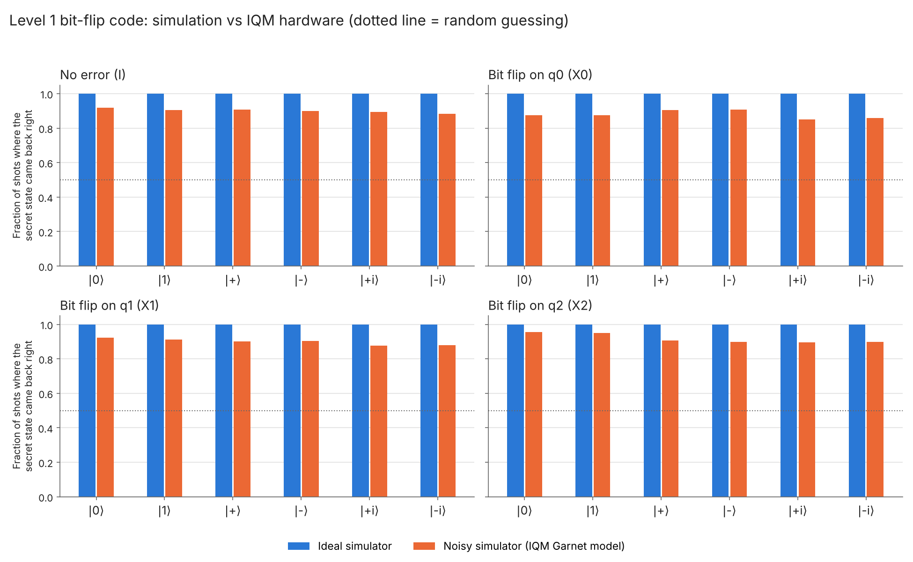
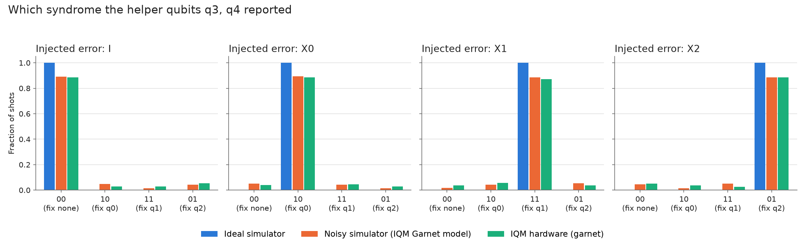

# Level 1 on IQM quantum hardware

This folder runs the Level 1 bit-flip code (from `../level1.py`) on a perfect
simulator, on a noisy model of IQM's Garnet chip, and on the real IQM
computer, then plots all three side by side.

| File | What it is |
| --- | --- |
| `run_level1_iqm.py` | Builds the Qiskit circuits and runs them (`simulate`, `hardware`, `fetch`, `plot`, `draw`). |
| `plot_level1_iqm.py` | Draws the comparison plots. |
| `results/` | Saved counts (`ideal.json`, `noisy_fake_garnet.json`, `hardware.json`) and plots. |
| `../tests/test_iqm_circuit.py` | Checks all 24 Qiskit circuits are perfect on the ideal simulator. |

## What gets run

24 circuits: 6 test states (|0⟩, |1⟩, |+⟩, |−⟩, |+i⟩, |−i⟩) × 4 errors (I, X0, X1, X2),
1000 shots each on hardware, all sent as **one job**.

Each circuit is exactly the Level 1 circuit (encode, error, syndrome with helpers
q3 and q4, decode) with two hardware-friendly choices:

1. **All measurements at the end, correction in software.** The helpers are
   measured at the end and the syndrome table picks which qubit to fix. The fix
   (an X) is applied to the *reading* instead of the qubit. This is called
   Pauli-frame correction and is what real QEC experiments do. It is exactly
   equivalent, because an X just before a measurement only flips how the result
   is read, and it avoids slow, noisy mid-circuit measurements.
2. **Each state is read in its own basis.** |0⟩, |1⟩ in Z, |+⟩, |−⟩ in X (H first),
   |+i⟩, |−i⟩ in Y (S† then H). This checks the phases survived, not just 0/1.

The compiled circuits are small: 5 qubits, at most 11 two-qubit gates on Garnet.

## Running it

```
pip install -r iqm/requirements-iqm.txt
python iqm/run_level1_iqm.py simulate     # free, no token
python iqm/run_level1_iqm.py hardware     # needs IQM_TOKEN, uses credits
python iqm/run_level1_iqm.py plot
```

The token is read from the `IQM_TOKEN` environment variable. Never put it in a file in this repo.
Use `--computer emerald` (or another name from the IQM Resonance dashboard) to pick a different machine.
If the window closes while waiting, the job id is in `results/hardware_job.json`; get the results with
`python iqm/run_level1_iqm.py fetch <job id>`.

## Simulation results (noisy Garnet model, 4000 shots)

* Ideal simulator: every one of the 24 cases succeeds 100% of the time.
* Noisy model: the syndrome is right about 89% of the time and the secret comes back
  right about 90% of the time on average.
* With correction switched off, X0 on |0⟩, |1⟩, |±i⟩ fails about 90–95% of the time,
  so the correction is clearly doing its job.
* X errors on |+⟩, |−⟩ do no harm even without correction, because X leaves |±⟩ unchanged.
* When there is no error, the correction slightly *lowers* success (about 0.92 instead of 0.96
  for |0⟩), because noise sometimes produces a false syndrome and we then "fix" a good qubit.

## Hardware results (IQM Garnet, 22 Nov 2026)

Run on the real **IQM Garnet** computer through IQM Resonance: one job of 24 circuits,
1000 shots each (job `01a202da-c692-7434-9e70-49c39c4a7717`, submitted 10:43 UTC).
Raw counts are in [`results/hardware.json`](results/hardware.json).
Run the commands above from inside `level1_python/`.




| | Ideal simulator | Noisy Garnet model | Real Garnet |
| --- | --- | --- | --- |
| Secret state recovered (average of 24 cases) | 100% | 89.9% | **89.2%** |
| Syndrome correct (average) | 100% | 89.0% | **88.2%** |

Success after correction on hardware, per case (1000 shots each):

| State | I | X0 | X1 | X2 |
| --- | --- | --- | --- | --- |
| \|0⟩ | 95.7% | 88.4% | 92.7% | 97.4% |
| \|1⟩ | 91.1% | 83.8% | 86.9% | 86.0% |
| \|+⟩ | 91.4% | 90.3% | 90.5% | 89.1% |
| \|−⟩ | 90.1% | 89.2% | 88.9% | 89.1% |
| \|+i⟩ | 90.0% | 83.7% | 86.7% | 89.3% |
| \|−i⟩ | 88.7% | 86.1% | 88.2% | 88.4% |

### What we observe

* **The hardware matches the noise model closely**: 89.2% vs 89.9% average success, so the
  noise model of Garnet is a good prediction of the real chip.
* **The correction clearly works.** An X error on q0 is the one that damages the secret
  (q0 holds it after decoding). Without correction it comes back right only 4.1 to 10.5% of the
  time on |0⟩, |1⟩, |+i⟩, |−i⟩; with correction it comes back right 83.7 to 88.4% of the time.
  (X on q1 or q2 does not reach q0 after decoding, and X does not change |+⟩, |−⟩, so those
  cases look fine even without correction.)
* **|1⟩ is a bit worse than the model predicts** (for example X2 on |1⟩: 86.0% on hardware vs 95.1%
  in the model). A likely reason is that a qubit in |1⟩ can decay to |0⟩ (T1 relaxation) and
  reading out 1 is less reliable than reading out 0. This is our interpretation, not something we measured separately.
* **With no error, correction slightly lowers success** (|0⟩: 95.7% with correction, 97.8% without),
  because noise sometimes produces a false syndrome and we then "fix" a qubit that was fine.
  A 3-qubit code only pays off when real errors are more likely than errors made by the check itself.
* The remaining ~10% failure comes from the noise of the 11 two-qubit gates and readout in each circuit,
  which this small code cannot protect against.
