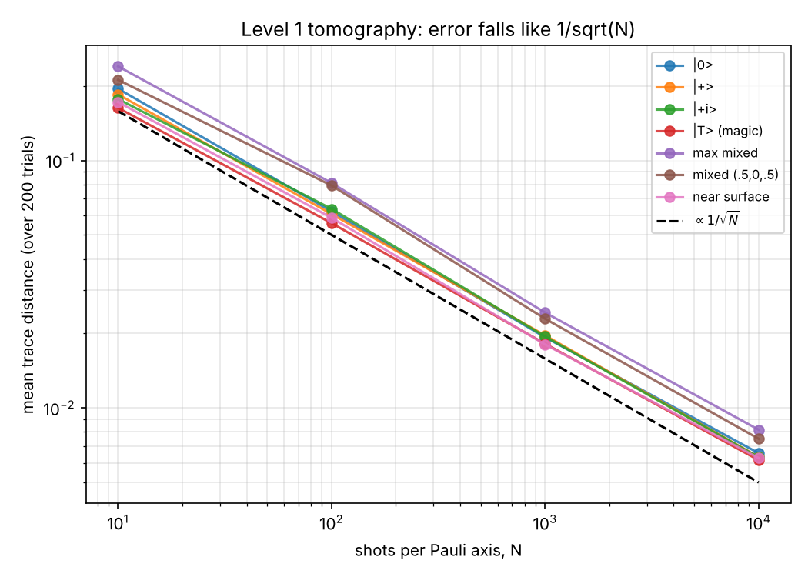

# Magic State Verification — Level 1: Reconstruct the State

Plain-NumPy single-qubit state tomography from simulated Pauli X, Y, Z measurements.

## Files

| File | What it does |
|---|---|
| `tomography.py` | Simulator (makes ±1 shots) and estimator (turns counts into ρ̂). Heavily commented. |
| `experiments.py` | Reconstructs 7 test states, prints error tables, saves the plot. |
| `tests/test_tomography.py` | 62 pytest checks (physicality, error shrinks with N, reproducibility, ...). |
| `results/error_vs_shots.png` | Error vs. number of shots (generated by `experiments.py`). |

## How to run

From the repository root (the `QuantumHackathon` folder):

```bash
pip install -r magic_state/requirements.txt
python magic_state/experiments.py      # prints tables, writes results/error_vs_shots.png
python -m pytest magic_state -q        # runs the tests (expect "62 passed")
```

All randomness uses `numpy.random.default_rng(2026)`, so every run prints the same numbers.

## Explanation for the judges

**What we measure.** We prepare (simulate) many fresh copies of an unknown qubit state ρ.
On each copy we measure one Pauli observable, X, Y or Z, and get +1 or −1. We spend N shots on
each axis (3N shots total). The simulator returns +1 with probability (1 + Tr(ρP))/2, exactly as
in the brief. The estimator only receives the counts (N₊, N₋) per axis; it never sees the true state.

**Why r_x = ⟨X⟩.** Every qubit state can be written ρ = ½(I + r_x X + r_y Y + r_z Z), where the
Bloch vector r has length ≤ 1 (length 1 = pure, less than 1 = mixed). Since Tr(XY) = Tr(XZ) = 0 and
Tr(X²) = 2, taking Tr(ρX) leaves only r_x. So r_x is the average value of an X measurement, and we
estimate it with the sample average

  r̂_P = (N₊ − N₋) / N.

**How ρ is rebuilt.** Put r̂ = (r̂_x, r̂_y, r̂_z) into ρ̂ = ½(I + r̂·σ). This is automatically Hermitian
with trace 1. Its eigenvalues are (1 ± |r̂|)/2, so it is positive semidefinite only if |r̂| ≤ 1.
Shot noise can push |r̂| above 1, so in that case we rescale r̂ to length 1 (keep the direction,
land on the sphere). The output is then always a valid density matrix.

**Cross-check.** Real hardware only measures Z. `p_plus_via_rotation` applies H (for X) or S†
then H (for Y), evolves ρ' = UρU†, and reads P(+1) = ρ'[0,0]. It agrees exactly with (1 + r_P)/2
for every test state (printed by `experiments.py`, checked in the tests).

## Results

States tested: |0⟩, |+⟩, |+i⟩, the magic state |T⟩ = cos(π/8)|0⟩ + sin(π/8)|1⟩ (r = (0.707, 0, 0.707)),
the maximally mixed state (0,0,0), a mixed state (0.5, 0, 0.5), and a state just inside the surface
(0.6, 0.55, 0.57), |r| ≈ 0.995. Mean over 200 trials (N = shots per axis):

| State | N=10 | N=100 | N=1000 | N=10000 | rescaled (N=1000) |
|---|---|---|---|---|---|
| \|T⟩ magic | 0.163 | 0.056 | 0.018 | 0.0062 | 49% |
| \|0⟩ | 0.195 | 0.062 | 0.019 | 0.0066 | 100% |
| max mixed | 0.240 | 0.081 | 0.024 | 0.0082 | 0% |
| mixed (0.5,0,0.5) | 0.212 | 0.079 | 0.023 | 0.0075 | 0% |
| near surface | 0.172 | 0.059 | 0.018 | 0.0063 | 40% |

(values are mean trace distance ½‖ρ̂ − ρ‖₁; full table including Bloch distance in the script output)

Every one of the 5,600 reconstructions was Hermitian, PSD and trace 1. The error drops by about
√10 ≈ 3.2 for each 10× more shots, i.e. it falls like 1/√N, which is what shot noise predicts
(each r̂_P has standard deviation √((1 − r_P²)/N)).



## Limitations and failure modes

1. **Shot noise.** Error only falls like 1/√N: to halve the error you need 4× the shots. With N = 10
   per axis the trace-distance error is ~0.2, which is far too coarse to verify a magic state.
2. **Rescaling is a fix, not an estimate.** For pure states (|0⟩, |+⟩, ...) the raw estimate lands
   outside the sphere about half or more of the time, because the components along the other two
   axes are pure noise. Rescaling makes ρ̂ valid, but it always outputs a *pure* state in those
   cases, so it cannot tell "pure" from "very slightly mixed". It is also not the statistically
   optimal correction (maximum-likelihood or Bayesian estimation would be better).
3. **Mixed states are harder.** States near the centre have the largest per-shot variance
   (1 − r_P² is largest when r_P = 0), so the maximally mixed state has the highest error at every N.
4. **Ideal measurements assumed.** No readout errors are modelled here; Level 3 adds them.
5. **Not shot-efficient for fidelity.** Full tomography spends shots on Y even though F_T only
   depends on r_x and r_z. Level 2 addresses this.
