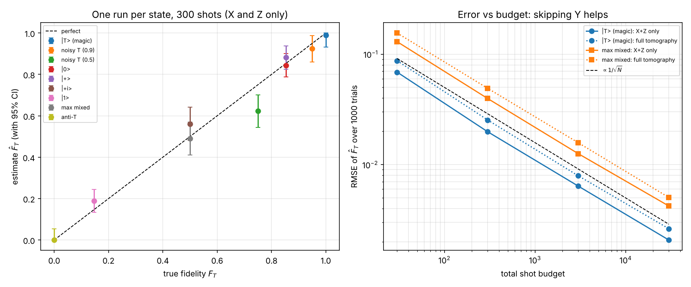

# Magic State Verification — Levels 1 and 2

Plain NumPy. Level 1 reconstructs a single-qubit state from simulated Pauli X, Y, Z measurements.
Level 2 estimates the fidelity F_T with the magic state |T⟩ using X and Z shots only (see [Level 2](#level-2--estimate-the-fidelity) below).

## Files

| File | What it does |
|---|---|
| `tomography.py` | Simulator (makes ±1 shots) and estimator (turns counts into ρ̂). Heavily commented. |
| `experiments.py` | Reconstructs 7 test states, prints error tables, saves the plot. |
| `tests/test_tomography.py` | 62 pytest checks (physicality, error shrinks with N, reproducibility, ...). |
| `results/error_vs_shots.png` | Error vs. number of shots (generated by `experiments.py`). |
| `fidelity.py` | **Level 2** estimator: X and Z counts → F̂_T with error bar. Reuses the Level 1 simulator. |
| `experiments_level2.py` | **Level 2** experiments: 9 states, 4 budgets, 1000 trials, coverage check, tomography comparison. |
| `tests/test_fidelity.py` | **Level 2** pytest checks, including the brief's 200-shot example (0.988). |
| `results/fidelity_level2.png` | Level 2 plot (generated by `experiments_level2.py`). |

## How to run

From the repository root (the `QuantumHackathon` folder):

```bash
pip install -r magic_state/requirements.txt
python magic_state/experiments.py          # Level 1: prints tables, writes results/error_vs_shots.png
python magic_state/experiments_level2.py   # Level 2: prints tables, writes results/fidelity_level2.png (~10 s)
python -m pytest magic_state -q            # runs all tests (expect "134 passed")
```

All randomness uses `numpy.random.default_rng(2026)`, so every run prints the same numbers.

## Explanation for the judges

**What we measure.** We prepare (simulate) many fresh copies of an unknown qubit state ρ.
On each copy we measure one Pauli observable, X, Y or Z, and get +1 or −1. We spend N shots on
each axis (3N shots total). The simulator returns +1 with probability (1 + Tr(ρP))/2, exactly as
in the brief. The estimator only receives the counts (N₊, N₋) per axis; it never sees the true state.

**Why r_x = ⟨X⟩.** Every qubit state can be written ρ = ½(I + r_x X + r_y Y + r_z Z), where the
Bloch vector r has length ≤ 1 (length 1 = pure, less than 1 = mixed). Since Tr(XY) = Tr(XZ) = 0 and
Tr(X²) = 2, taking Tr(ρX) leaves only r_x. So r_x is the average value of an X measurement, and we
estimate it with the sample average

  r̂_P = (N₊ − N₋) / N.

**How ρ is rebuilt.** Put r̂ = (r̂_x, r̂_y, r̂_z) into ρ̂ = ½(I + r̂·σ). This is automatically Hermitian
with trace 1. Its eigenvalues are (1 ± |r̂|)/2, so it is positive semidefinite only if |r̂| ≤ 1.
Shot noise can push |r̂| above 1, so in that case we rescale r̂ to length 1 (keep the direction,
land on the sphere). The output is then always a valid density matrix.

**Cross-check.** Real hardware only measures Z. `p_plus_via_rotation` applies H (for X) or S†
then H (for Y), evolves ρ' = UρU†, and reads P(+1) = ρ'[0,0]. It agrees exactly with (1 + r_P)/2
for every test state (printed by `experiments.py`, checked in the tests).

## Results

States tested: |0⟩, |+⟩, |+i⟩, the magic state |T⟩ = cos(π/8)|0⟩ + sin(π/8)|1⟩ (r = (0.707, 0, 0.707)),
the maximally mixed state (0,0,0), a mixed state (0.5, 0, 0.5), and a state just inside the surface
(0.6, 0.55, 0.57), |r| ≈ 0.995. Mean over 200 trials (N = shots per axis):

| State | N=10 | N=100 | N=1000 | N=10000 | rescaled (N=1000) |
|---|---|---|---|---|---|
| \|T⟩ magic | 0.163 | 0.056 | 0.018 | 0.0062 | 49% |
| \|0⟩ | 0.195 | 0.062 | 0.019 | 0.0066 | 100% |
| max mixed | 0.240 | 0.081 | 0.024 | 0.0082 | 0% |
| mixed (0.5,0,0.5) | 0.212 | 0.079 | 0.023 | 0.0075 | 0% |
| near surface | 0.172 | 0.059 | 0.018 | 0.0063 | 40% |

(values are mean trace distance ½‖ρ̂ − ρ‖₁; full table including Bloch distance in the script output)

Every one of the 5,600 reconstructions was Hermitian, PSD and trace 1. The error drops by about
√10 ≈ 3.2 for each 10× more shots, i.e. it falls like 1/√N, which is what shot noise predicts
(each r̂_P has standard deviation √((1 − r_P²)/N)).


## Limitations and failure modes

1. **Shot noise.** Error only falls like 1/√N: to halve the error you need 4× the shots. With N = 10
   per axis the trace-distance error is ~0.2, which is far too coarse to verify a magic state.
2. **Rescaling is a fix, not an estimate.** For pure states (|0⟩, |+⟩, ...) the raw estimate lands
   outside the sphere about half or more of the time, because the components along the other two
   axes are pure noise. Rescaling makes ρ̂ valid, but it always outputs a *pure* state in those
   cases, so it cannot tell "pure" from "very slightly mixed". It is also not the statistically
   optimal correction (maximum-likelihood or Bayesian estimation would be better).
3. **Mixed states are harder.** States near the centre have the largest per-shot variance
   (1 − r_P² is largest when r_P = 0), so the maximally mixed state has the highest error at every N.
4. **Ideal measurements assumed.** No readout errors are modelled here; Level 3 adds them.
5. **Not shot-efficient for fidelity.** Full tomography spends shots on Y even though F_T only
   depends on r_x and r_z. Level 2 addresses this.

---

# Level 2 — Estimate the Fidelity

## Method

The fidelity with the magic state is

  F_T = ⟨T|ρ|T⟩ = ½ (1 + (r_x + r_z)/√2).

It does **not** depend on r_y, so shots spent on Y are wasted. We split the whole budget evenly
between X and Z (an odd budget gives X the extra shot), estimate r̂_x and r̂_z with the same
counting rule as Level 1, r̂_P = (N₊ − N₋)/N, and plug them in. Shot noise can push the raw number
slightly outside [0, 1] (each r̂ is in [−1, 1], so r̂_x + r̂_z can reach 2), so we clip F̂ to [0, 1].
The estimator (`estimate_fidelity`) takes only the counts; the true state goes into the simulator only.

**Error bar.** Each r̂_P is an average of N independent ±1 outcomes, so SE(r̂_P) ≈ √((1 − r̂_P²)/N).
F is linear in r_x and r_z with slope 1/(2√2), and the X and Z shots are independent, so

  SE(F̂) = (1/(2√2)) √(SE_x² + SE_z²).

We report F̂ ± 1.96·SE as an approximate 95% confidence interval (clipped to [0, 1]).

**The brief's example.** 200 shots, X: 84/16, Z: 85/15 gives r̂_x = 0.68, r̂_z = 0.70,
F̂ = 0.988 ± 0.036, 95% CI [0.917, 1.000]. This is a unit test.

## Results

States: |T⟩ (F = 1), T with depolarising noise r = 0.9·r_T (F = 0.95) and r = 0.5·r_T (F = 0.75),
|0⟩ and |+⟩ (F = 0.854), |+i⟩ (F = 0.5, a pure state with no X or Z component), |1⟩ (F = 0.146),
the maximally mixed state (F = 0.5) and the anti-T state −r_T (F = 0). Budgets are **total** shots.
Seed 2026, 1000 trials per cell.

| State | F_T | RMSE @30 | @300 | @3000 | @30000 | CI coverage @3000 | tomography RMSE @3000 |
|---|---|---|---|---|---|---|---|
| \|T⟩ magic | 1.000 | 0.069 | 0.020 | 0.0064 | 0.0021 | 97.3% | 0.0079 |
| noisy T (0.9) | 0.950 | 0.081 | 0.031 | 0.0101 | 0.0032 | 94.6% | 0.0126 |
| noisy T (0.5) | 0.750 | 0.123 | 0.038 | 0.0122 | 0.0039 | 94.5% | 0.0145 |
| \|0⟩ | 0.854 | 0.087 | 0.028 | 0.0093 | 0.0030 | 94.3% | 0.0108 |
| \|+i⟩ | 0.500 | 0.130 | 0.040 | 0.0125 | 0.0041 | 96.6% | 0.0152 |
| max mixed | 0.500 | 0.130 | 0.040 | 0.0126 | 0.0042 | 95.1% | 0.0158 |
| anti-T | 0.000 | 0.067 | 0.020 | 0.0067 | 0.0021 | 97.4% | 0.0077 |

(full table for all 9 states, including mean stated SE, is printed by the script)

What this shows:

1. **The estimate tracks the truth.** In a single 300-shot run per state, 8 of 9 95% intervals
   contained the true F (left panel of the plot). Missing 1 in 9 is about what a 95% interval should do.
2. **Error falls like 1/√N.** RMSE drops by about √10 ≈ 3.2 for every 10× more shots. To verify
   F to ±0.01 you need a few thousand shots.
3. **The error bars are honest.** Over 1000 repeats, the 95% interval covered the truth 93–98% of the
   time for states in the interior, from 300 shots up, and the stated SE matches the actual spread.
4. **Skipping Y beats full tomography.** At the same total budget, Level 1 tomography (budget/3 per
   axis, then read F off ρ̂) has about 1.2× the RMSE. That matches theory: X+Z gets N/2 shots per axis
   instead of N/3, so the variance is 2/3 as large, and √1.5 ≈ 1.22. Equivalently, tomography needs
   about 50% more shots for the same accuracy.



## Limitations and failure modes

1. **Error bars are approximate at small budgets.** The interval uses a normal approximation and
   plugs in r̂ for the unknown r. With 30 shots, coverage drops to 90–93% for |0⟩ and |1⟩: when
   r_z = ±1 every Z shot agrees, so the estimated SE_z is exactly 0 and the interval is too narrow.
   A Wilson or Clopper–Pearson interval per axis, or a Hoeffding bound, would fix this.
2. **Clipping at the boundary.** For |T⟩ (F = 1) and anti-T (F = 0), clipping pulls estimates
   towards the truth, so RMSE is smaller than the stated SE and coverage is 97–99% instead of 95%:
   the interval is conservative right at the edge. Clipping also makes F̂ slightly biased there
   (it can only err downwards from 1).
3. **Fidelity does not identify the state.** F only sees r_x + r_z. |+i⟩ (pure) and the maximally
   mixed state both have F = 0.5, and |0⟩ and |+⟩ both have F = 0.854. That is fine for scoring a
   magic state, but this method cannot tell you *what went wrong* with a bad state; tomography can.
4. **Equal split is not always optimal.** Splitting shots in proportion to √(1 − r_P²) would reduce the
   variance a little when r_x and r_z differ, but it needs a first guess of r and the gain is small
   near |T⟩, where r_x = r_z.
5. **Ideal measurements assumed.** No readout errors yet; with a flip rate ε every r̂ shrinks by
   (1 − 2ε) and F̂ is biased towards 0.5. Level 3 addresses this.
